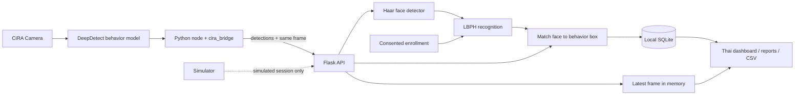

# เอกสารประกอบการส่งโครงงาน

## ชื่อ
ระบบต้นแบบเช็คชื่อด้วยใบหน้าและสรุปพฤติกรรมในห้องเรียน ร่วมกับ CiRA CORE สำหรับบริบทมหาวิทยาลัยศรีปทุม

## ปัญหาและวัตถุประสงค์
การเช็คชื่อด้วยมือใช้เวลาระหว่างเรียน และผู้สอนสังเกตทั้งห้องได้ยาก โครงงานนี้ศึกษาการตรวจจับภาพและฐานข้อมูลเพื่อช่วยบันทึกการเข้าเรียน และสรุปภาพรวมความตั้งใจเรียน/การหลับในห้อง โดยแยก “จำนวนคนที่เห็นในภาพ” ออกจาก “ตัวบุคคลที่รู้จักและเช็คชื่อแล้ว” อย่างชัดเจน ผลพฤติกรรมใช้ประกอบการสังเกตของผู้สอน ไม่ใช้ตัดคะแนน

## สถาปัตยกรรม

## ขอบเขต
ห้องเรียนหนึ่งคาบที่เปิดอยู่ กล้องหนึ่งแหล่งหลัก ข้อมูลนักศึกษาเก็บในเครื่อง ใช้การยินยอมก่อนลงทะเบียน แยกข้อมูล biometric ออกจาก public source code และลบข้อมูลเมื่อไม่จำเป็น ภาพจาก CiRA เก็บเฉพาะเฟรมล่าสุดในหน่วยความจำ ตรวจการใช้โทรศัพท์เป็นฟีเจอร์ทดลองที่ปิดไว้ก่อน

## แผนทดลองที่ต้องทำจริง
| สถานการณ์ | สิ่งที่บันทึก |
|---|---|
| ไม่มีคน / 1 คน / 3 คน | จำนวนจริง จำนวนที่ตรวจพบ และเงื่อนไขแสง |
| นักศึกษาลงทะเบียน หันตรง/เอียง | TP/FN และเวลาต่อภาพ |
| คนที่ไม่ลงทะเบียน | False acceptance / Unknown |
| แสงน้อย หน้าบัง หรือไกลกล้อง | ความผิดพลาดและข้อจำกัด |
| นักศึกษาคนเดิม 5 ครั้ง | มีเช็คชื่อครั้งเดียวต่อคาบ |
| เปิดคาบใหม่ | เช็คชื่อเดิมได้อีกครั้ง |
| CiRA ส่งข้อมูลหลังปิดคาบ | API ปฏิเสธ session เก่า |
| ลบข้อมูลนักศึกษา | ใบหน้าและประวัติคนนั้นหายจากฐานข้อมูล |
| นั่งตั้งใจ / ก้มเขียน / ฟุบหลับ / หันคุย | ผลโมเดลเทียบกับที่ผู้สังเกตจดไว้ ทีละท่า |
| ฟุบหลับโดยไม่เห็นหน้า | นับในยอดหลับของห้อง แต่ไม่ผูกกับชื่อ |
| สองคนนั่งชิดกัน | ผูกพฤติกรรมกับคนถูกต้อง หรือไม่ผูกเลย ต้องไม่ผูกผิดคน |
| ใช้โทรศัพท์ (ถ้าเปิด) จากกล้องหน้าห้อง | สัดส่วนที่มองเห็นจริง เพื่อตัดสินใจว่าจะเก็บหรือตัดฟีเจอร์นี้ |

ยังไม่มีผลทดลองกล้องจริงและยังไม่มีโมเดลพฤติกรรม อย่าใส่เปอร์เซ็นต์ความแม่นยำหรือจำนวนผู้ทดลองที่ไม่ได้เก็บจริง ตัวเลขจากตัวจำลองเป็นข้อมูลสุ่ม ห้ามใช้เป็นผลทดลอง ใช้ผู้ร่วมทดลองที่ยินยอมและรายงานทั้งความสำเร็จและข้อผิดพลาด

## ลำดับสาธิต 5 นาที
1. อธิบายปัญหาและขอบเขต (30 วินาที)
2. เปิดกล้อง ลงทะเบียนผู้ร่วมทดลองที่ยินยอม (1 นาที)
3. เปิดคาบ เช็คชื่อผู้ลงทะเบียนและคนที่ไม่ลงทะเบียน (1 นาที)
4. แสดง CiRA flow ที่เชื่อมจริงและหน้าห้องเรียนสด หากยังไม่มีโมเดลให้ใช้ตัวจำลองและบอกผู้ชมชัดเจนว่าเป็นข้อมูลจำลอง (1 นาที)
5. เปิดหน้ารายงาน ส่งออก CSV ปิดคาบ อธิบายข้อจำกัดและแนวทางพัฒนา (1.5 นาที)

## สิ่งที่ต้องเติมก่อนส่ง
ชื่อสมาชิก รหัสนักศึกษา ชื่ออาจารย์ รายวิชา รุ่นของ CiRA CORE ที่ใช้งาน ชื่อคลาสของโมเดลพฤติกรรมที่ฝึกจริง ภาพ flow จริง และผลทดลองจริง โค้ดนี้เป็นต้นแบบตั้งต้น ไม่ใช่หลักฐานว่าได้ทดลองกับนักศึกษา SPU แล้ว
